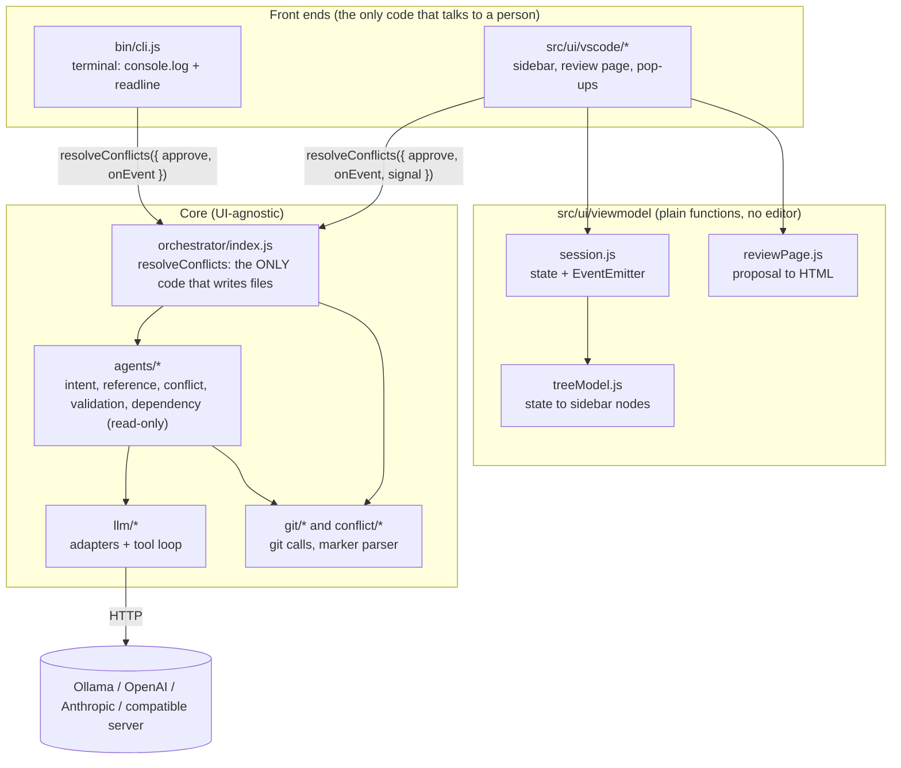
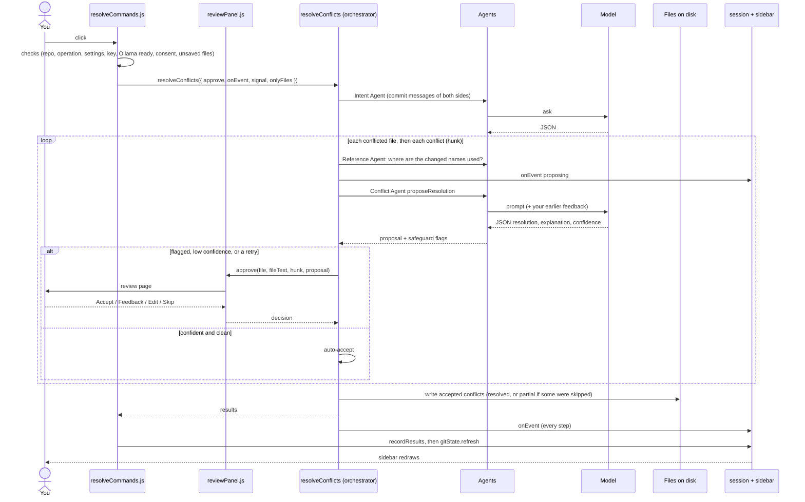
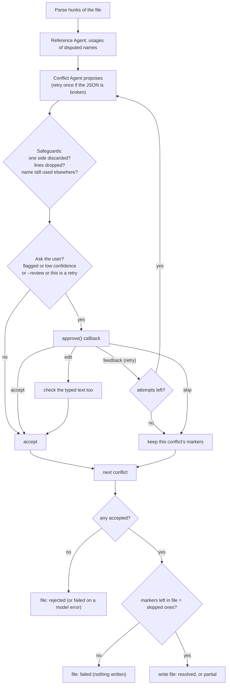
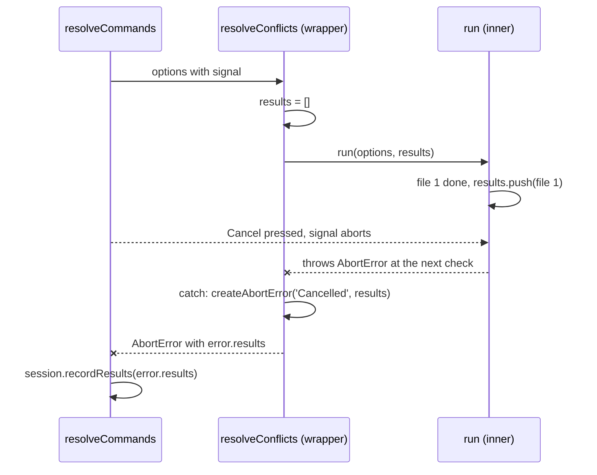
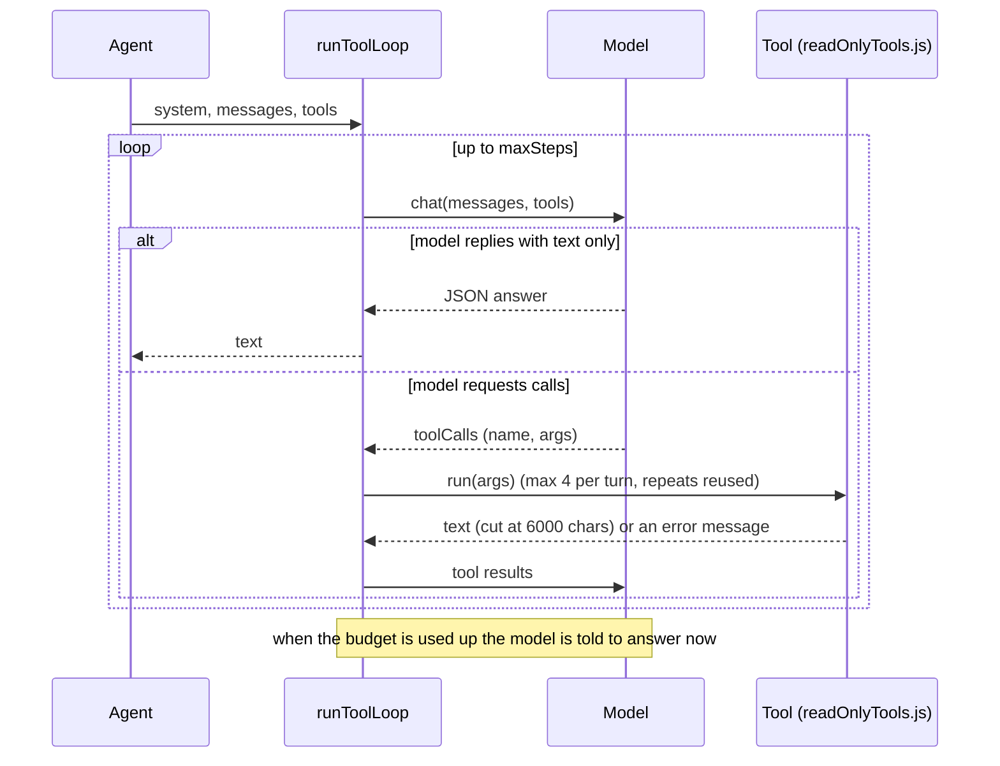
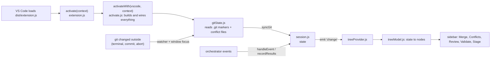
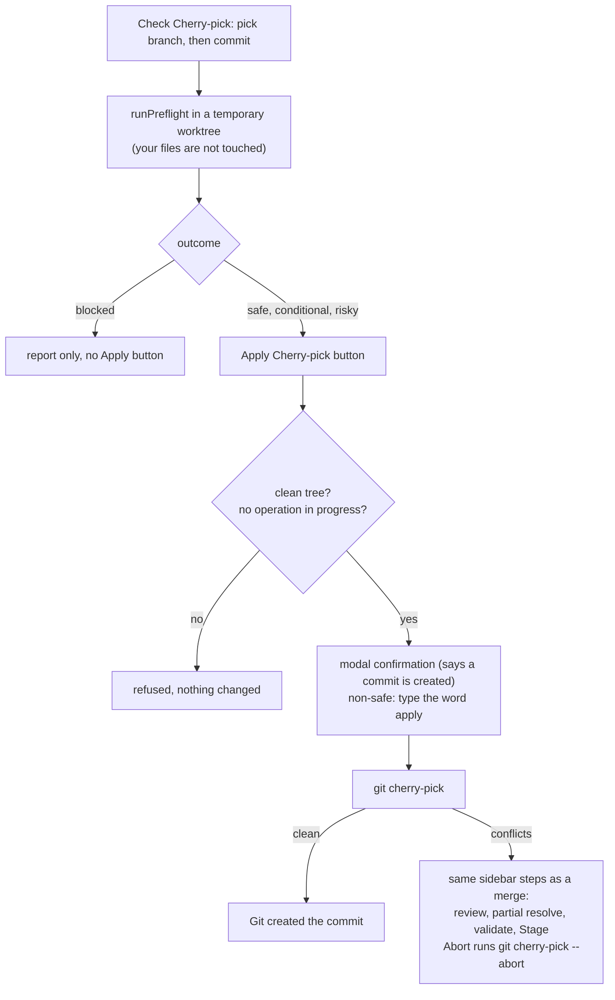

# merge-conflict-agent

A multi-agent Git assistant with two tools:

- **`resolve-conflicts`** resolves merge conflicts with an LLM, keeps you in control of every uncertain decision, and refuses to stage anything until your repo's own checks pass.
- **`cherry-pick-check`** tells you whether a commit is safe to cherry-pick *before* you change anything: what must already be on the target branch, and what a trial pick in a temporary worktree reveals.

> **Status: learning project.** Two command-line tools and a first version of a VS Code extension, all built on one UI-agnostic core. The extension is tested against a simulated editor and has not yet been tried by hand in a real VS Code window; see [VS Code extension](#vs-code-extension). See [PLAN.md](PLAN.md) for the original design.

## Why

A clean textual merge does not guarantee working code, and an LLM that "merges" a conflict can quietly revert one side's change or delete a declaration while sounding confident. This tool treats the model as an advisor:

- It proposes a resolution for each conflict hunk.
- Code-side safeguards flag proposals that look wrong, whatever the model claims.
- You approve, give feedback, edit, or skip.
- The CLI stages nothing until the repo's tests, lint, typecheck and build pass. The VS Code extension stages only when you click Stage and confirm.

## Requirements

- Node.js 20 or newer (developed and tested on 22)
- Git on your `PATH`
- One LLM provider: OpenAI, Anthropic, or a local [Ollama](https://ollama.com) server

## Setup

```bash
npm install
cp .env.example .env     # then edit .env
npm link                 # optional: installs the `resolve-conflicts` command globally
```

### Choosing a model

Everything is configured in `.env`; no code changes are needed to switch providers.

| Provider | `.env` |
|---|---|
| OpenAI | `PROVIDER=openai`, `LLM_MODEL=gpt-4o-mini`, `API_KEY=sk-...` |
| Anthropic | `PROVIDER=anthropic`, `LLM_MODEL=<claude model>`, `API_KEY=sk-ant-...` |
| Ollama (local, free) | `PROVIDER=ollama`, `LLM_MODEL=llama3.1` (no key; run `ollama pull llama3.1` first) |
| Other OpenAI-compatible (Groq, ...) | `PROVIDER=openai`, `BASE_URL=<endpoint>`, `API_KEY=...` |

Optional: `JSON_MODE=false` if an OpenAI-compatible server rejects `response_format`.

Small local models are fine for trying the tool but make more mistakes. The safeguards below catch many of them, but expect more approval prompts than with a larger model.

## Usage

Run it inside a repository that is in the middle of a merge, cherry-pick or rebase with conflicts:

```bash
resolve-conflicts --dry-run     # propose fixes, write nothing
resolve-conflicts               # apply fixes, asking you when unsure
resolve-conflicts --validate    # also run the repo's checks afterwards
resolve-conflicts --stage       # git add resolved files, only if checks pass
```

Without `npm link`, use `node /path/to/merge-conflict-agent/bin/cli.js ...` from inside the target repo.

| Flag | Meaning |
|---|---|
| `--cwd <dir>` | Repository directory (default: current directory) |
| `--review` | Ask for approval on every hunk, not just uncertain ones |
| `--validate` | After resolving, run the repo's checks (test, typecheck, lint, build) |
| `--stage` | `git add` resolved files, only if validation passes (implies `--validate`) |
| `--no-intent` | Skip reading commit messages to learn why each branch changed |
| `--no-references` | Skip looking for other uses of the changed names, importers and affected tests |
| `--tools` | Let the model call read-only tools (read files, search, git history) while it works. Off by default; see [Tool calling](#tool-calling-optional) |
| `--dry-run` | Propose resolutions but do not write any files |

Colors are used on terminals; set `NO_COLOR=1` to turn them off.

### When it asks you

```
[a]ccept / [f]eedback (propose again) / [e]dit (type it yourself) / [s]kip file >
```

- **accept**: use the proposal.
- **feedback**: tell the model what to change ("keep both, timeout stays 60"). It sees its rejected attempt plus your comment and proposes again. A revised proposal always comes back to you. Up to 5 attempts per hunk.
- **edit**: type the replacement yourself; finish with a line containing only `.`.
- **skip**: leave this conflict as it was. The other conflicts in the same file are still resolved, so a file can end up partly resolved (the summary says how many conflicts are left).

## How it works

A master orchestrator coordinates read-only specialist agents. Only the orchestrator writes files or stages changes.

1. **Detect** conflicted files and parse conflict hunks (plain and diff3 markers).
2. **Intent Agent** reads the commit messages on both sides (for a merge, cherry-pick or rebase) and summarizes what each side was trying to achieve. The summary is passed to the next step. Commit messages are the only source for now; see [Intent sources](#intent-sources).
3. **Reference Agent** (before the proposal) finds where the names that the two sides disagree about are used elsewhere in the repository, and passes that to the Conflict Agent so it does not drop something still in use.
4. **Conflict Agent** proposes a resolution for each hunk using the base, ours and theirs versions plus surrounding code.
5. **Safeguards** (in code, independent of the model) require your approval when a resolution keeps only one side verbatim, is missing lines that a side added or changed, or drops or changes a name that is still used elsewhere in the repository (the Reference Agent checks the proposal too). These show up as `Flagged:` lines, and the prompt lists `Used elsewhere:` call sites.
6. **You decide**: accept, give feedback, edit, or skip.
7. **Apply** the resolution, confirm no conflict markers remain, and write the file. The Reference Agent also records which files import it and which test files are affected.
8. **Validation Agent** (with `--validate` / `--stage`) runs the affected test files first, then the repo's full checks in order, stopping at the first failure.
9. **Stage** resolved files only if every check passed. If no checks are found, or any file is unresolved, nothing is staged.

A failure in one hunk or one model reply never crashes the run: bad JSON is retried once, and a file that still fails is reported and left untouched.

### Reference analysis

A clean textual merge can still break code elsewhere, so the Reference Agent looks beyond the conflicted file. It is read-only and needs no model:

1. **What the sides disagree about.** It reads the declarations in the ours, theirs and base versions of each hunk (functions, arrow functions, constants, classes, types, enums, methods and object keys; JS/TS only) and keeps the ones that differ.
2. **Who uses them.** `git grep` finds other uses in the repository, skipping `node_modules`, lock files, build output and the hunk itself. Very short names and generic object keys such as `id` or `name` are skipped to avoid noise.
3. **What the proposal does to them.** A name is reported when the proposal drops it, or discards the version of a side that changed it (a side only counts as having changed a name relative to the base). If the name is still used elsewhere, the proposal is flagged and needs your approval.
4. **Who imports the file.** Relative `import` / `require` paths are resolved, so a same-named file in another folder is not confused with it.
5. **Which tests to run first.** Test files that import the file or mention a changed name run before the full suite, so a broken merge fails in seconds. This works for `node --test`, Jest, Vitest and Mocha, and is skipped when the runner is not recognized or when `.merge-agent.json` defines the commands.

This is text matching, not a compiler: it can report false positives and miss dynamic usage (names built from strings), alias imports such as `@/utils`, config files and schemas. The search sits behind a small `finder` function, so an editor's "find all references" can replace it in the VS Code extension. If it fails for any reason, it is reported once and the run continues without it. Turn it off with `--no-references`.

### Intent sources

The Intent Agent answers "why did each side change this?" so the Conflict Agent can resolve a contradiction by purpose, not just by text. It combines whatever evidence is available.

**Used today**

- Commit messages (subject and body, up to 20 commits per side, preferring commits that touch the conflicted files). For a cherry-pick or rebase, "theirs" is exactly the one commit being replayed.

**Planned** (ideas, not built yet; roughly in order of expected value)

- **Pull request title, description and linked issues**, via the GitHub / GitLab / Bitbucket API or CLI. This is usually the best statement of intent and is also what the cherry-pick preflight needs.
- **Issue tracker tickets** referenced in commit messages or branch names (for example `PROJ-123`), including the ticket's description and acceptance criteria.
- **Branch names** such as `hotfix/session-timeout`, as a cheap hint.
- **What the commits actually changed**: the diff itself, and any tests added or modified alongside it. A test that asserts `SESSION_MINUTES === 15` says more than the commit message does.
- **Review comments** on the pull requests, where reviewers often explain why a value was chosen.
- **Repository docs**: `CHANGELOG`, architecture decision records, `CONTRIBUTING`, and code comments near the conflict.
- **Ownership**: `CODEOWNERS` and blame, so an ambiguous conflict can say who to ask instead of guessing.

Every source is treated as untrusted data, never as instructions to the model. The agent should also say when the evidence is thin ("unclear") instead of inventing a purpose, and results should state which sources were actually used. When remote PR information is unavailable, the tool will say that its answer is based only on local repository state.

### Tool calling (optional)

By default the code decides what the model sees (the hunk, nearby code, commit messages, where the contested names are used). With `--tools` the model can also ask for more while it works, the way a developer would open another file or check the history. Tool calling is an extra step on top of the fixed pipeline, and everything the pipeline guarantees still applies: the safeguards, your approval, and validation.

The model only *requests* a call; this program decides to run it, and every tool is read-only:

| Tool | What it does |
|---|---|
| `read_file` | Lines of a file in the working tree, numbered, up to 200 lines per call |
| `find_references` | Whole-word search for a name across the repo |
| `list_importers` | Files that import a given JS/TS file through a relative path |
| `get_conflict_stages` | The base, ours or theirs version of a conflicted file |
| `git_log` | Recent commits touching a path, for ours, theirs or both |
| `git_show` | One commit's message, files and patch (hex sha only) |
| `git_blame` | Who last changed a line range, on either side |

The Conflict Agent gets all of them. The Intent Agent only gets `git_log`, `git_show` and `read_file`, so it can read specific commits and docs instead of only the latest messages.

**Safety rules**

- No tool writes, stages or runs repository code. Only the orchestrator writes files.
- Paths are limited to the repository, symlinks are resolved first, and files that commonly hold secrets (`.env*`, `*.pem`, `*.key`, `id_rsa*`, `.npmrc`, `.git/`) are blocked. The same files are left out of search results and `git show` output.
- Each model turn runs at most 4 calls, each result is capped, a repeated identical call is not run twice, and a run has a budget of 8 steps per question; after that the model must answer.
- Tool output is treated as untrusted data, and the prompt says so.
- Every call is printed as it happens (for example `[Conflict Agent] read_file(path="checkout.js")`), and the approval prompt lists which tools the model used.

**If the model cannot use tools** (many small local models cannot), the first failure is reported once, tools are turned off for the rest of the run, and resolving continues without them.

**Privacy:** with a cloud provider (OpenAI, Anthropic), whatever a tool returns is sent to that provider as part of the conversation, in addition to the code already in the prompt. Use a local Ollama model if that is not acceptable.

### Validation checks

The Validation Agent uses, in priority order:

1. `.merge-agent.json` in the repo root:
   ```json
   { "validate": ["npm test", { "name": "lint", "command": "npm run lint" }] }
   ```
2. Otherwise the `test`, `typecheck` (or `type-check` / `tsc`), `lint` and `build` scripts in `package.json`, using npm, yarn or pnpm depending on the lock file.

Each command has a 10 minute timeout, and a timeout kills the whole process tree. These commands run on your machine, so only use `--validate` in repositories you trust.

## Technical flow (with diagrams)

Maintaining the code? Start with the [developer guide](docs/DEVELOPER_GUIDE.md): commands, configuration, a file-by-file map, data shapes, both end-to-end flows, safety rules, tests and how to change things.

The diagrams use [Mermaid](https://mermaid.js.org/); GitHub and VS Code's Markdown preview draw them.

### 1. The layers

Two front ends sit on one core. The core never imports `vscode`; a front end gives it two callbacks: `approve` (ask the user) and `onEvent` (report progress). `scripts/checkArchitecture.js` enforces the split.



### 2. What happens when you click "Resolve Conflicts with AI"



### 3. The decision loop for one conflict

This is the inside of `resolveConflicts` (`src/orchestrator/index.js`, three nested loops: file, conflict, attempt).



### 4. Cancelling mid-run



`results` is created in the wrapper and passed in by reference, so what `run` pushed before the throw is still there. Cancel is checked between files and conflicts, passed to the model request, and wired to the validation runner, which kills the process tree.

### 5. Optional tool calling (`--tools` / `useTools`)

The model only asks; this code runs the read-only tool and sends the text back.



If the model or server rejects tools, `askWithOptionalTools` falls back to a plain request and switches tools off for the rest of the run. A cancel is never treated as "tools unsupported".

### 6. The extension: startup and live updates



The session has two sources of truth: **git** (what is on disk, so a reload loses nothing) and **run events** (what the AI is doing right now). Everything on screen is derived from the session.

### 7. Applying a cherry-pick



## Cherry-pick preflight

```bash
cherry-pick-check <commit>                  # report only; nothing in your repo changes
cherry-pick-check <commit> --onto release   # check against another branch
cherry-pick-check <commit> --validate       # also run tests/lint/build on the simulated result
cherry-pick-check <commit> --apply          # after the report, offer the real cherry-pick
cherry-pick-check <commit> --json           # machine-readable report
```

(Run `npm link` again after updating so the new command is registered, or use `node bin/preflight.js`.)

A cherry-pick can apply cleanly as text and still break the target branch, for example when the commit calls a function that an earlier, unmerged commit introduced. The preflight looks for that before you commit to anything.

**What it checks** (the Dependency Agent, read-only and deterministic, no model needed)

1. **Already applied?** If the commit, or an identical change, is already on the target, there is nothing to do.
2. **Lines it depends on.** For every line the commit edits or removes, `git blame` finds who wrote it. If that commit is not on the target, it is a **confirmed prerequisite**.
3. **Names, files and packages it needs.** Functions it calls, local files it imports and npm packages it uses are looked up on the target. If one is missing but existed just before the commit, the commits that introduced it become confirmed prerequisites. If nothing provides it, the pick is blocked.
4. **Possible prerequisites.** Other unmerged commits that touch the same files, kept apart from the confirmed ones because nothing proves the commit needs them.
5. **Concurrent work.** Other local and remote-tracking branches with unmerged commits on the same files.
6. **A trial pick** in a temporary `git worktree` of the target. It reports a clean pick, an empty one or conflicts, and then lists names the commit removed or re-signed that other files still use. With `--validate` it also runs the repo's checks there, with your `node_modules` made visible through a link that is removed again afterwards.

Your branch, index and working files are never touched; the worktree is deleted when the check ends.

**Outcomes**

| Outcome | Meaning |
|---|---|
| Safe | Nothing found. Always shown as "local analysis only" until open pull requests can be checked |
| Conditional | Other commits must be applied first (listed oldest first) |
| Risky | Concurrent or unexplained changes: a conflict with no known cause, work on another branch, or names still used that the pick removes |
| Blocked | A required dependency is missing and nothing provides it, the trial pick errored, validation failed, or it is a merge commit |

Every report lists the evidence, the files changed, the prerequisites, what the trial pick did and what was validated. The real cherry-pick only happens through `--apply`, after you type `yes`, and only on a clean working tree on the target branch. If it stops on conflicts, run `resolve-conflicts`.

Limits in this first version: one commit at a time (no ranges or merge commits), name and import analysis for JS/TS only, alias imports such as `@/utils` are not resolved, a prerequisite's own prerequisites are only found by checking it again after applying it, and no model is involved yet. Open pull requests are not checked, which is why a result is never a plain "safe".

## VS Code extension

The same core is available as a VS Code extension, **Merge Assistant** (in [extension/](extension/)): a sidebar that walks through Merge, Conflicts, Review and Validate.

- **Start a merge** from the UI (`git merge --no-ff --no-commit`, with confirmation, a clean tree required and an Abort button). It never creates a commit.
- **See the conflicts** as a list of files and conflicts, each opening at its line.
- **Resolve with AI**: confident answers are applied; doubtful ones open a review page in the editor with ours, theirs and the proposal side by side (lines a side changed are marked as in the proposal or missing from it), then Accept, Give feedback (typed in the page; the model proposes again) or Skip this conflict. In a file with several conflicts, what you accept is kept when you skip another one. The run can be cancelled and finished files are kept.
- **Run checks** after showing the exact commands first (a merge brings in code from another branch, which may have changed them).
- **Set Up AI Model** is a guided wizard for choosing where the AI runs: Ollama on your computer, OpenAI, Claude, or another OpenAI-compatible server. It lists the models you can actually use (the ones you have downloaded, or that your key gives access to), takes your API key into VS Code's secret storage, and saves only after one real test request works; if it fails, it says why (key rejected, model not found, Ollama not running...). Each key is kept against its own server, so your OpenAI key can never be sent to some other address.
- **Check or Apply Cherry-pick** gives the preflight report. After a check that is not blocked you can apply it (clean tree required, with a confirmation; a clean pick is committed by Git, conflicts continue into the usual steps and Abort works). It can also copy the `git cherry-pick` command.
- **A merge never commits; stages only on request.** (An applied cherry-pick that has no conflicts is committed by Git itself, after a confirmation that says so.) Git keeps listing resolved files as conflicts until they are staged, so a **Stage Resolved Files** button marks the files it resolved (after you confirm the list and see what the checks said). You review and commit in Source Control.

```bash
npm run ext:install     # once: installs the extension's build tools
npm run ext:build       # bundles the extension and the core into extension/dist
npm run ext:package     # builds extension/merge-assistant-0.1.0.vsix
```

To try it without installing, open the `extension` folder in VS Code and press F5. To get a repository to merge, run `node scripts/makeDemoRepo.js <folder> --no-merge` and open that folder in the new window. Settings, privacy notes and limits are in [extension/README.md](extension/README.md).

**How the code is split.** Only `src/ui/vscode/extension.js` imports the `vscode` module; every other file receives the editor API as a parameter, so it is tested with a fake editor. The sidebar state and tree (`src/ui/viewmodel/`) are plain functions with no editor dependency. API keys go in VS Code secret storage, and the extension never reads a `.env` file.

## Try it on a demo

```bash
npm run demo:pick     # a repo with a feature branch: one independent commit, one hidden dependency, one edit of unmerged lines
```

It prints three `cherry-pick-check` commands to try and what to expect from each.

### Demo conflict for `resolve-conflicts`

```bash
npm run demo
```

This builds a throwaway repo, mid-merge, with three conflicts of rising difficulty (an easy one, a medium one and a deliberately ambiguous one) and prints the command to run against it.

## Project layout

```
bin/cli.js                  CLI entry point (the `resolve-conflicts` command)
bin/preflight.js            CLI entry point (the `cherry-pick-check` command)
src/orchestrator/           master agent: the only code that writes files or stages
src/preflight/              cherry-pick preflight: trial pick, outcome rules, report, apply
src/agents/
  conflictAgent.js          proposes resolutions, flags suspicious ones
  intentAgent.js            explains each side's purpose from commit messages
  referenceAgent.js         finds where changed names are used, importers, affected tests
  dependencyAgent.js        finds what a commit needs on the target branch (prerequisites, missing names/files)
  validationAgent.js        runs the repo's own checks (affected tests first)
src/conflict/               conflict-marker parser and resolution applier
src/git/                    thin wrappers around the git CLI (history queries, worktrees)
src/llm/                    provider-agnostic client + OpenAI / Anthropic adapters, tool-call loop,
                            model listing (models.js) and the connection test (testConnection.js)
src/tools/                  the read-only tools a model may call (with the repo sandbox)
src/config/                 settings validation (the CLI-only .env loader is src/config/loadEnv.js)
src/util/                   cancellation helpers (AbortSignal)
src/ui/colors.js            terminal colors
src/ui/viewmodel/           editor-independent sidebar state, tree, review and summary text
src/ui/vscode/              VS Code glue (only extension.js imports `vscode`)
extension/                  extension manifest, build script and README (bundles ../src)
scripts/                    architecture check, demo repo generators
test/                       node:test suite (uses real temporary git repos)
```

`npm test` runs an architecture check first: only `src/ui/vscode/` may import `vscode`, and `src/` may not use `import.meta` or `dotenv` outside `src/config/loadEnv.js` (they break when the core is bundled into the extension). That keeps the core reusable by both the CLI and the extension.

## Testing

```bash
npm test
```

Tests use fake models, so they need no API key and no network. Integration tests create real temporary git repositories with genuine conflicts.

## Roadmap

- [x] LLM adapters (OpenAI, Anthropic, Ollama)
- [x] Conflict detection, parsing and application
- [x] Conflict Agent with safeguards, feedback and edit loop
- [x] Validation Agent gating staging
- [x] Intent Agent (commit messages)
- [ ] More intent sources: PR descriptions and linked issues, ticket text, diffs and tests, review comments, repo docs (see [Intent sources](#intent-sources))
- [x] Reference Agent: callers, importers and affected tests (text based, JS/TS)
- [ ] Reference Agent v2: model check of call-site compatibility, more languages, editor-grade references in VS Code
- [x] Optional read-only tool calling for the Conflict and Intent agents (`--tools`)
- [ ] More tools: `run_tests` (needs an approval prompt), `fetch_pr` / `fetch_issue` (needs remote access)
- [x] Dependency Agent and cherry-pick preflight (prerequisites, missing names, trial pick in a temporary worktree)
- [ ] Preflight v2: commit ranges, merge commits, transitive prerequisites, more languages, model-assisted judgment of possible overlaps
- [ ] Remote PR awareness (GitHub / GitLab / Bitbucket)
- [x] VS Code extension v0.1: guided merge, AI review in diffs, cancellable runs, checks, cherry-pick report, local `.vsix`
- [ ] Try the extension by hand in VS Code and fix what that shows; then a `vscode.lm` (Copilot) provider, editing a proposal inside the diff, an SCM-view menu, and Marketplace publishing

## Known limitations

- Only tested against a local Ollama model so far; the OpenAI and Anthropic adapters are covered by unit tests but not yet by live calls.
- Tool calling (`--tools`) is covered by tests with scripted models and message-format checks for both providers, but has not been tried against a real model yet. Whether it works depends on the model: strong hosted models handle it well, small local ones often cannot.
- The "missing lines" safeguard is a text comparison, so it can flag a good merge that rewrites lines. It errs on the side of asking you.
- Intent summaries are only as good as the commit messages, the only source used so far (more are planned, see [Intent sources](#intent-sources)).
- Reference analysis only understands JS/TS declarations and is text based (see [Reference analysis](#reference-analysis)).
- The VS Code extension has been tested against a simulated editor (and its packaged bundle is loaded and activated against a stub), but not yet used by hand in a real VS Code window, so layout, icons and the feel of the prompts are unverified.
- Piping answers into the prompts (`printf 'a\n' | resolve-conflicts`) does not work; the prompts expect an interactive terminal.
- Binary, delete and rename conflicts are reported and skipped.
- Without remote PR access, results are based only on local repository state. The cherry-pick preflight therefore never reports a plain "safe".
- The cherry-pick preflight checks one commit at a time, and its name analysis is text based and JS/TS only. It has been tried on demo repositories and in tests, not yet on a large real-world repository.
